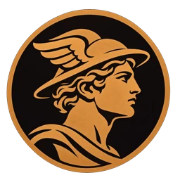
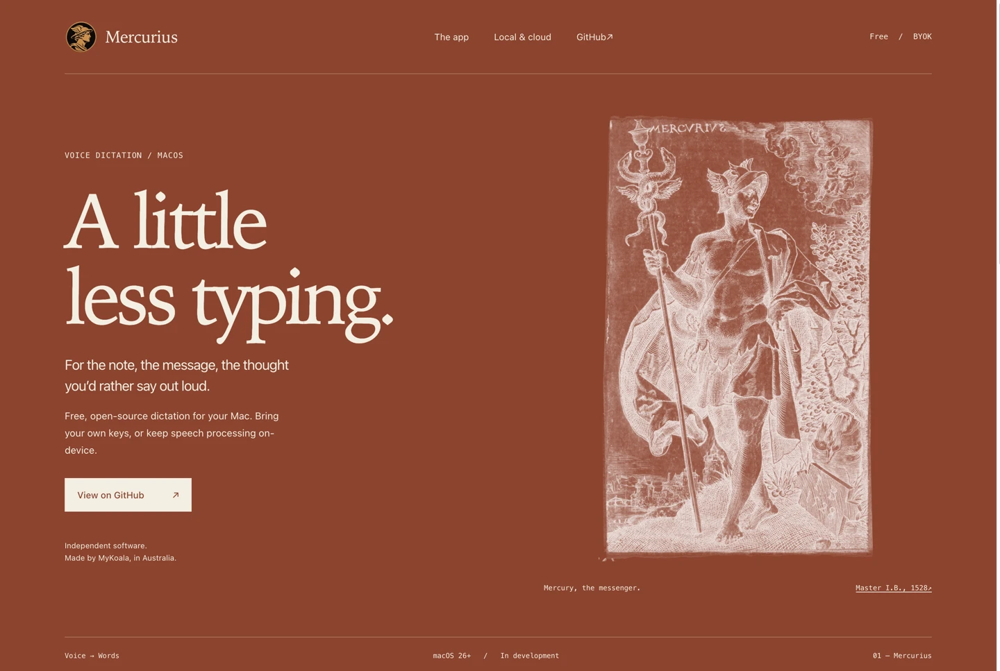

<p align="center"></p>

# Mercurius

**Free dictation for your Mac. Bring your own keys.**

Mercurius is a native macOS dictation app from [MyKoala](https://mykoala.com.au/). This repository contains an MIT-licensed source preview, tests, the Koa animation generator and the public website. The app is under active validation. **There is no verified public installer yet.**

[Website](https://mercurius.mykoala.com.au/) · [Contributing](CONTRIBUTING.md) · [Security](SECURITY.md) · [MIT code licence](LICENSE)

[](https://mercurius.mykoala.com.au/)

*Website design preview. The live site carries the current publication-status wording; this image is not a native-app demo.*

## What it does

Hold the configured dictation shortcut, speak, and release. Mercurius recognises your speech, optionally cleans up the transcript, and delivers it to the focused editor or keeps it available to copy. Koa and a waveform show recording progress.

The source includes on-device Apple speech, OpenRouter cloud transcription/cleanup and direct ElevenLabs Scribe. You supply your own provider keys. The personal dictionary starts empty; users add their own terms and explicit replacements. Per-app styles, recovery, clipboard/history views and usage reporting are implemented. Additional native capture and web-clipping tools are included; they need their own Accessibility/browser/Screen Recording permissions and native testing.

These are implemented features, not a claim of compatibility with every editor or parity with every dictation product. Accuracy, latency and provider availability depend on the engine, language, hardware and account.

## Local and cloud processing

| Mode | What leaves your Mac | Provider charges |
|---|---|---|
| On-device speech, cloud cleanup off | No audio or transcript; the public model-price catalogue can still be fetched | No speech/cleanup API charge |
| On-device speech with cloud cleanup | Transcript, app context and dictionary hints go to OpenRouter | Your selected cleanup model |
| OpenRouter speech | Audio goes to OpenRouter and the selected provider; cleanup may be a separate text request | Your transcription and optional cleanup models |
| ElevenLabs Scribe | Audio and dictionary keyterms go to ElevenLabs; optional cleanup goes to OpenRouter | Your ElevenLabs credits/billing plus optional cleanup |

Bring-your-own-key does not mean cloud processing happens locally. Provider retention and free-model training policies apply. The app requests denied data collection for normal OpenRouter routes; free catalogue routes can require different terms. Read the in-app labels before selecting one.

Each user saves their own keys into macOS Keychain through an explicit Save action. No working API key, developer Keychain, signing credential or private account configuration is included here. Avoid putting keys in command arguments or source files.

The public source uses bundle ID `au.com.mykoala.mercurius` and separate Keychain/log/outbox namespaces. It does not read a developer's prototype keys or settings. Internal Swift target/executable names still use CursusVox. Data folders use Mercurius names; there is no automatic migration from the private prototype.

## Build from source

Requirements: an Apple Silicon Mac, macOS 26 or later, a toolchain supporting the Swift 6.2 package manifest, and your own Apple Development or Developer ID Application signing identity for a bundled app. There are no Swift package dependencies.

```sh
git clone https://github.com/SHAMALKRISHNA/Mercurius.git
cd Mercurius
swift test --jobs 2 --no-parallel
python3 Tests/ScriptTests/public_export.test.py
python3 Tests/ScriptTests/build.test.py
python3 scripts/check-public.py
```

To build a local app, set `MERCURIUS_SIGNING_IDENTITY` to your own identity and run:

```sh
sh scripts/build-app.sh
```

The script prints a new `dist/Mercurius.XXXXXXXX/Mercurius.app` path. It does not install or launch the app, read API keys, unlock a Keychain or overwrite an existing installation. If your signing identity is in a separate unlocked Keychain, set `MERCURIUS_SIGNING_KEYCHAIN` to its path. Ad-hoc signing is not supported. It bundles the code, artwork and third-party licence notices in `Contents/Resources/Licences.txt`. This contributor build is not a notarised public release.

Open that built app yourself, then follow setup. Microphone is needed for recording. Accessibility supports shortcuts and insertion; speech recognition supports Apple speech/live preview. Browser automation and Screen Recording are only for the associated capture tools. Permissions after a rebuild can depend on your signing identity.

Some Command Line Tools installations fail to find Swift's TestingMacros plugin. Prefer a compatible full Xcode toolchain. If your installed toolchain already contains the plugin, its explicit `-Xswiftc -load-plugin-library -Xswiftc /path/to/libTestingMacros.dylib` flags can resolve discovery. Do not download a random plugin binary.

## Testing and current limits

The initial snapshot is intended for local developer testing. The default serial suite passes with three opt-in live speech/YouTube checks skipped. Automated policy, cleanup, capture, credential, UI and asset fixtures are included. AppKit fixtures must run serially. Unit tests do not prove microphone recording, physical shortcuts, focus safety, editor delivery, login startup or recognition quality on another Mac.

Current limits include 60-second dictation recordings, English-oriented cloud transcription, Apple Silicon/macOS 26+, and varying editor Accessibility support. The current live words appear in the recording pill; they are not continuously typed at the caret. Final insertion and clipboard fallback still need editor-specific testing.

When you clip a YouTube page, the app attempts to fetch captions through an undocumented YouTube player endpoint using an iOS client identifier. This is not an official YouTube API integration; it can be refused or stop working when YouTube changes the service. No logged-in YouTube account is used.

Private audio/TTS fixtures are intentionally not distributed. The opt-in `CURSUS_TEST_LOCAL_SPEECH` checks need separately authored fixtures and installed Apple speech assets; they are not part of the default reproducible test run. Live-provider, physical microphone and native delivery checks are not CI acceptance. Do not enable live-provider tests without controlling your own account costs.

Usage totals can be approximate when a provider omits charges. ElevenLabs credit balance is account-wide. Budget warnings are not a hard spending cap, and token-priced audio costs may need additional price-unit qualification.

## Koa and visual identity

Koa is one plush grey koala with a cream muzzle and orange headset. The app selects seven transparent 24 fps clips: entrance, calm listening, expressive listening, thinking, success, error and shrug. These total about 1.34 MB and decode once into small frames. System Reduce Motion and Still keep Koa still. Walking and speech-synchronised talking are not implemented.

`Design/Koa/koa_build.py` rebuilds the character and clips in Blender 5.2. `--save` creates an editable master with all seven actions and a 208-frame timeline. Generated `.blend` files stay untracked because Blender can retain local workstation metadata. The included master-check script validates the saved poses. `Design/Koa/encode.swift` encodes complete frame sets through AVFoundation.

Code and render scripts use MIT. Original Koa/Mercurius artwork is CC BY 4.0; trademark rights are reserved. The website's historical Mercury illustration is a public-domain 1528 etching from the Met. [Artwork credits and terms](LICENSE-ARTWORK.md) and [third-party notices](THIRD-PARTY-NOTICES.md) identify the separate rights. The self-hosted website fonts have separate [SIL Open Font License notices](apps/web/assets/fonts/README.md).

## Development

`Sources/CursusCore` owns policy and cleanup rules; `Sources/CursusVox` and `CursusPlatform` adapt native APIs. `Tests` contains deterministic fixtures. `apps/web` is a dependency-free static site with no application keys, login or backend. You can preview those static files with any local static server.

Please submit small, reproducible issues and pull requests. Strip private transcripts, recordings, credentials and screenshots before sharing. For confidential reports, follow [SECURITY.md](SECURITY.md).

Mercurius is free software; external APIs can cost money. This project is independent of Wispr, Superwhisper, OpenRouter, ElevenLabs and Apple. No third party endorses it.
